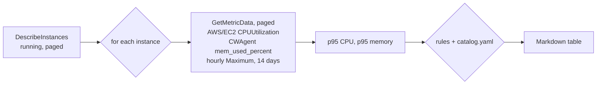

# EC2 rightsizing advisor

A read-only Python tool that looks at the last two weeks of CPU and memory
use for running EC2 instances and suggests one size down, one size up, or
no change, using a small instance catalog you edit in YAML. It prints a
Markdown table and never changes anything.

> **Status:** AWS EC2 with CloudWatch metrics is implemented and unit tested
> against hand-written fake EC2 and CloudWatch clients (34 tests, including
> missing-memory, too-little-data, API-error and bad-config cases). It has
> **not** been run against a real account. **Azure is an interface stub
> only** (`AzureMonitorSource` raises `NotImplementedError`, and
> `--provider azure` exits with an error).

## Problem

> Write a tool that rightsizes EC2/Azure VMs by comparing CloudWatch/Azure
> Monitor CPU/memory utilization against instance type recommendations.

## How it works



For each instance:

1. Fetch hourly **Maximum** CPU and memory for the lookback window. Hourly
   maximum is used so short spikes are not averaged away.
2. Take the **p95** of those hourly values (nearest-rank, no
   interpolation). This ignores the busiest ~5% of hours.
3. Apply the rules:

| Condition | Result |
|---|---|
| type not in `catalog.yaml` | `unknown` |
| fewer than `min_datapoints` CPU values | `unknown` |
| p95 CPU > `cpu.high` or p95 memory > `memory.high` | `up` one size (or `keep` if already largest) |
| memory data missing or too thin | `unknown`, memory shown as `unknown` |
| p95 CPU < `cpu.low` **and** p95 memory < `memory.low` | `down` one size (or `keep` if already smallest) |
| anything else | `keep` |

Memory is only published when the **CloudWatch agent** is installed on the
instance. Without it, a downsize could starve the instance of RAM, so the
tool reports `unknown` instead of guessing. The one exception is high CPU:
that alone is enough evidence to size up, so the `up` result still shows,
with memory as `unknown`.

### Example output (from the CLI test)

```
| Instance | Type | p95 CPU | p95 memory | Action | Suggested type | Reason |
|---|---|---:|---:|---|---|---|
| i-0000000000000001 | m5.2xlarge | 4.0% | 12.0% | down | m5.xlarge | CPU and memory below low thresholds |
| i-0000000000000002 | m5.large | 93.0% | 50.0% | up | m5.xlarge | p95 CPU above threshold |
| i-0000000000000003 | m5.xlarge | 4.0% | unknown | unknown | - | no memory data (CloudWatch agent?) |

3 instances: 1 down, 1 up, 0 keep, 1 unknown. Nothing was changed.
```

## Usage

```bash
python -m pip install -r requirements-dev.txt
python -m ruff check .
python -m ruff format --check .
python -m pytest -q

# Real run (needs credentials with the read-only permissions below)
python -m rightsizer --region eu-west-2
python -m rightsizer --instance-id i-0123456789abcdef0 --output rightsizing.md
python -m rightsizer --config my-catalog.yaml
```

Permissions needed: `ec2:DescribeInstances`, `cloudwatch:GetMetricData`.
Exit code is `1` on any API error, bad config, or when no running
instances are found.

## Configuration (`config/catalog.yaml`)

- `thresholds`: lookback days, period, percentile, minimum datapoints, and
  low/high bands for CPU and memory.
- `families`: ordered size lists, smallest first. "One size down" is the
  previous entry in the same family. A type listed twice is a config error.

The default catalog has four families (`t3`, `m5`, `c5`, `r5`). Extend it
for the types you run.

## Limits

- AWS EC2 only. Azure is an interface stub, not implemented.
- Moves one size within a family only. It does not suggest a different
  family (for example `m5` to `c5` or to Graviton) and does not price
  anything.
- Memory is read from `CWAgent` / `mem_used_percent` with only the
  `InstanceId` dimension. If your agent config appends more dimensions
  (such as `ImageId`, `InstanceType`), the query will find nothing and the
  result will be `unknown`. Adjust the dimensions in `metrics.py` to match.
- Burstable `t3` sizes share vCPU counts and depend on CPU credits; p95
  CPU alone does not capture credit balance.
- Network, disk, and GPU usage are not considered.
- One `GetMetricData` request per instance; CloudWatch bills per metric
  requested, so very large fleets cost a little to scan.

## Security notes

- Read-only. The code calls only `DescribeInstances` and `GetMetricData`;
  the test fakes implement only those two calls, so any write call would
  fail the tests.
- No credentials in code; boto3 uses the standard credential chain.

## Idempotency

The tool changes nothing, so it is safe to run any number of times. Two
runs at different times can differ because the lookback window moves.

## Layout

```
rightsizer/catalog.py   YAML config loading and validation, size neighbours
rightsizer/metrics.py   CloudWatch source (paged), Azure stub
rightsizer/advisor.py   p95 and the rightsizing rules
rightsizer/report.py    Markdown table
rightsizer/cli.py       instance listing (paged), args, exit codes
config/catalog.yaml     thresholds and instance families
```
